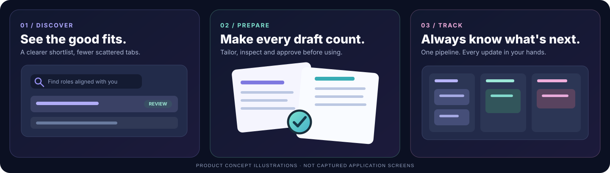
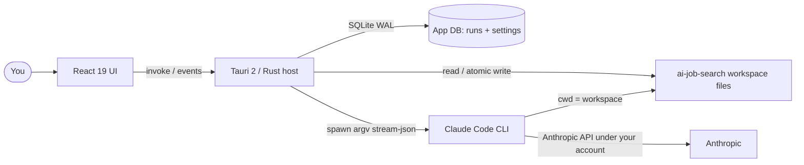

<p align="center">
  
</p>

<h1 align="center">AI Job Search Assistant</h1>

<p align="center">
  <strong>Less tab chaos. More career momentum.</strong><br />
  A local-first command center for discovering jobs, preparing honest applications, and tracking your search — with human approvals at every important step.
</p>

<p align="center">
  <a href="./docs/installation.md"><strong>Build from source</strong></a> ·
  <a href="https://ankitparekh007.github.io/job-search-assistant/"><strong>Explore the website</strong></a> ·
  <a href="./docs/getting-started.md"><strong>Get started</strong></a> ·
  <a href="https://github.com/AnkitParekh007/job-search-assistant/discussions"><strong>Join the discussion</strong></a>
</p>

<p align="center">
  <a href="./LICENSE"></a>
  <a href="./apps/macos-apple-silicon/"></a>
  <a href="https://github.com/AnkitParekh007/job-search-assistant/actions/workflows/ci.yml"></a>
  <a href="https://github.com/AnkitParekh007/job-search-assistant/stargazers"></a>
</p>

<p align="center"><sub>Independent community desktop companion inspired by <a href="https://github.com/ai-job-search-dev/ai-job-search">ai-job-search</a> by <a href="https://github.com/MadsLorentzen">Mads Lorentzen</a> and contributors. Not an official upstream release.</sub></p>

> [!NOTE]
> **Public release status:** Package version `0.1.0`; a downloadable installer has **not** been published. Build from source for now. macOS Apple Silicon is the primary supported client. AI workflows require a configured Claude Code or compatible experimental Codex integration; provider usage may incur costs.

---

## One workspace. Three big steps.

<p align="center">
  
</p>

Discover aligned roles, prepare tailored documents through the upstream workflows, then review and track the results from the desktop UI. **You approve actions and submit applications yourself** — the app does not auto-submit or send emails.

**The pictures above are original concept illustrations, not screenshots.** Real screenshots will be added after capturing a sanitized running desktop build. [Help with screenshots](./docs/assets/screenshots/README.md) · [Explore features](./docs/features.md).

---

## What's inside the desktop app

| **A visible agent workspace** | **A safer application workflow** |
|:---|:---|
| See job discovery, fit ranking, workflow progress, tool activity and the application pipeline in one place. | Review generated CVs and cover letters, inspect PDF output, and approve sensitive file or command actions before proceeding. |
| **Files remain yours** | **Designed for extensions** |
| Your candidate profile, tracker and application archives remain in your local upstream workspace. | Claude Code is the established execution path; an experimental Codex adapter is available on Apple Silicon, with other engines on the roadmap. |

**Need the technical view?** [Architecture](./docs/architecture.md) · [Workflow support](./docs/supported-workflows.md) · [Multi-provider status](./docs/MULTI-PROVIDER-IMPLEMENTATION.md)

---

## Why I built it

The upstream framework is powerful: local files, Claude Code workflows, and a serious job-search pipeline. I wanted that same rigor with a more approachable **visual** experience — one place to see discovery, ranking, Application Studio, the pipeline, and agent activity, with human approval before sensitive tools run.

AI Job Search Assistant is that desktop shell. Scout (the onboarding mascot) walks you through connecting a workspace; the rest stays local-first and under your control.

This project’s outcomes are its own. Do **not** treat upstream creator results as evidence for this app.

---

## How it works


1. **Connect** your local ai-job-search workspace  
2. **Discover** opportunities (`/scrape`)  
3. **Rank** fit scores and gaps (`/rank`)  
4. **Prepare** tailored CV / cover letter in Application Studio (`/apply`)  
5. **Review** drafts and tool approvals yourself  
6. **Track** status on the pipeline and record outcomes (`/outcome`)

Preparation and drafting are **not** confirmation that an application was submitted to an employer.

<details>
<summary><strong>Architecture (technical)</strong></summary>



- **Upstream workspace files** own jobs, applications, profile, CVs, and the tracker CSV.
- **SQLite** stores run history and app preferences only.
- Claude Code is the established runtime; the experimental OpenAI Codex adapter uses its own app-server protocol. There is no independent local-LLM backend. See the [provider implementation report](./docs/MULTI-PROVIDER-IMPLEMENTATION.md).

Deep dive: [Architecture](./docs/architecture.md) · [App architecture](./apps/macos-apple-silicon/docs/ARCHITECTURE.md)

</details>

---

## What makes it different

- **Human approvals** for write/exec tools; live agent timeline and cost metadata  
- **Desktop experience** — Jobs, Ranking, Studio, Pipeline, Documents in one shell  
- **Local ownership** — tracker, archives, and profile remain files on disk you own  
- **Honest boundaries** — no auto-submit, no silent email; provider usage depends on your configured account  

---

## Quick start (build from source)

Primary conversion path until a verified installer ships: **build the macOS Apple Silicon app from source**.

### Prerequisites

| Requirement | Why |
|-------------|-----|
| Apple Silicon Mac, macOS 13+ | Native arm64 Tauri target |
| [Claude Code](https://claude.ai/code) CLI, signed in | Runs every AI workflow (uses your Claude plan or API credits) |
| Python ≥ 3.10 | Upstream tools (`brew install python@3.12` recommended) |
| Local [ai-job-search](https://github.com/ai-job-search-dev/ai-job-search) checkout | Unmodified workspace the app drives |
| Node.js 20+ + npm | Frontend toolchain |
| Rust (stable) + Xcode CLT | Tauri native build |

Optional: BasicTeX + LuaLaTeX/XeLaTeX (PDF compile), poppler/`pdftotext` (ATS text check).

### Commands

```bash
# 1) Upstream workspace (source of truth)
git clone https://github.com/ai-job-search-dev/ai-job-search.git
# Follow upstream SETUP.md for profile / LaTeX as needed

# 2) This repository
git clone https://github.com/AnkitParekh007/job-search-assistant.git
cd job-search-assistant/apps/macos-apple-silicon

# 3) Install & verify
npm install
npm test
(cd src-tauri && cargo test)

# 4) Development
npm run tauri dev

# 5) Release .app (unsigned personal build)
npm run tauri build
open "src-tauri/target/release/bundle/macos/AI Job Search.app"
```

On first launch, select your upstream workspace (or change it in Settings).

**Gatekeeper:** unsigned builds may need **right-click → Open** the first time. Do not disable system security broadly.

Full guide: [Installation](./docs/installation.md) · First-run walkthrough: [Getting started](./docs/getting-started.md)

### First five minutes

1. Launch (`tauri dev` or the built `.app`).  
2. Select your **ai-job-search** workspace.  
3. Open **Settings → Dependencies** and fix anything red.  
4. Run **Profile setup** (`/setup`) or confirm an existing profile.  
5. **Discover** → **Rank** → open **Application Studio** → move cards on the **Pipeline**.

---

## Features and platform support

Capabilities are **Native** (UI / SQLite / local tools), **Upstream** (Claude Code slash commands), **External** (connectors), or **Planned**.

<details>
<summary><strong>Features by journey</strong></summary>

### Discover

- Search via upstream `/scrape` — **Upstream**
- Deduplicated `seen_jobs.json` with native Jobs views — **Native + Upstream**
- Portal / source visibility — **Upstream** (+ optional community portals)

### Evaluate

- AI-assisted ranking via `/rank` — **Upstream**
- Fit scores, verdicts, strengths, and gaps — **Native**
- Compare up to four ranked jobs — **Native**

### Prepare

- Resume and cover-letter drafting via Application Studio (`/apply`) — **Upstream**
- PDF compile, page count, ATS text check, preview — **Native**
- Posting integrity / prompt-injection pre-check — **Native**
- Tracker updated to **`drafted`** after preparation — **not** employer submission

### Track

- Kanban pipeline with validated transitions — **Native**
- Full `/outcome` recording and follow-up **drafts** (never auto-sent) — **Upstream**
- Application archives under `documents/applications/` — **Upstream files**

### Interviews

- Stage-specific prep via `/interview` — **Upstream**
- Dedicated practice-history UI — **Planned** ([roadmap](./docs/roadmap.md))

### Control your AI

- Live execution timeline, tool I/O, cost metadata — **Native**
- Human approvals for write/exec; read-only “allow for this run” — **Native**
- Stop, end session, retry, resume — **Native**

Details: [Features](./docs/features.md) · [Supported workflows](./docs/supported-workflows.md) · [Parity matrix](./apps/macos-apple-silicon/docs/FEATURE-PARITY-MATRIX.md)

</details>

| Platform | Path | Status |
|----------|------|--------|
| **macOS Apple Silicon** (M1–M4) | [`apps/macos-apple-silicon/`](./apps/macos-apple-silicon/) | **Developed client** — primary supported desktop app |
| macOS Intel (x86_64) | [`apps/macos-intel/`](./apps/macos-intel/) | Source-complete; release packaging not published |
| Windows | [`apps/windows/`](./apps/windows/) | Source-complete; release packaging not published |
| Web (browser) | [`apps/web/`](./apps/web/) | UI demo with sample data — **no** Claude Code bridge |

The **browser UI is a demo**, not a functional replacement for the desktop app. See [`apps/README.md`](./apps/README.md).

---

## Privacy, costs, and limitations

> **Do not push populated job-search workspaces, resumes, application records, or personal profile data to public Git repositories.** Keep real search data local (or in private remotes you control). Public forks of upstream or this repo should stay free of your private job-hunt files.

### Privacy and security

- No app telemetry or remote product backend.
- Credentials stay in Claude Code / connectors — not stored by this app.
- App data directory uses restrictive permissions; DB is mode `0600` on macOS.
- Write/exec tools require human approval; posting-integrity checks stay in the loop.
- Profile and posting content sent through Claude Code go to Anthropic under **your** account.

More: [Privacy & security](./docs/privacy-and-security.md)

### AI provider requirements and costs

| Item | Detail |
|------|--------|
| Providers | **Claude Code CLI** (established); **OpenAI Codex** adapter on Apple Silicon (experimental, not live end-to-end verified) |
| Cost | Depends on selected provider and authentication: Claude plan/API usage or Codex ChatGPT plan/API usage |
| Local LLM | Not supported in this product today |
| Disclosure | AI workflows consume the selected provider's usage allowances or credits; review its billing and limits |

### Key limitations

- Primary support target is **macOS Apple Silicon**.
- No published installer / GitHub Release binary yet.
- Does **not** auto-submit applications or send follow-up email.
- Gmail / Notion features need external connectors.
- Web client is a demo UI only.

---

## Community and roadmap

Help wanted in concrete areas:

- **Tauri / Rust** host and packaging  
- **Accessibility** and UI polish  
- **Provider integrations** (beyond Claude Code)  
- **Testing**, docs, and sanitized screenshots  

Starter ideas: [contributor backlog](./docs/contributor-backlog.md) · [CONTRIBUTING.md](./CONTRIBUTING.md)

- Bugs → [GitHub Issues](https://github.com/AnkitParekh007/job-search-assistant/issues) (use the bug form)  
- Features → Feature request form  
- Security → [SECURITY.md](./SECURITY.md) (do not file public issues for vulnerabilities)  
- Discussions → [Join the community conversation](https://github.com/AnkitParekh007/job-search-assistant/discussions)

Roadmap: [docs/roadmap.md](./docs/roadmap.md)

### Support this project

Sponsorship helps continued development, additional AI providers, platform ports, docs, and testing.

**[Become a GitHub Sponsor](https://github.com/sponsors/AnkitParekh007)**

A star, bug report, contribution, or recommendation is equally appreciated.

---

## Developer reference

<details>
<summary><strong>Documentation index</strong></summary>

| Doc | Description |
|-----|-------------|
| [Getting started](./docs/getting-started.md) | First-run path |
| [Installation](./docs/installation.md) | Prerequisites and build |
| [Architecture](./docs/architecture.md) | System design |
| [Configuration](./docs/configuration.md) | Workspace and settings |
| [Features](./docs/features.md) | Capability map |
| [Supported workflows](./docs/supported-workflows.md) | Upstream command catalog |
| [Job discovery](./docs/job-discovery.md) | Scrape / rank |
| [Application Studio](./docs/application-studio.md) | Draft / PDF / review |
| [Application tracking](./docs/application-tracking.md) | Pipeline / outcomes |
| [Interview preparation](./docs/interview-preparation.md) | Prep packs |
| [Integrations](./docs/integrations.md) | Gmail, Notion, portals |
| [Privacy and security](./docs/privacy-and-security.md) | Threat model summary |
| [Troubleshooting](./docs/troubleshooting.md) | Common failures |
| [FAQ](./docs/faq.md) | Short answers |
| [Roadmap](./docs/roadmap.md) | Near / medium / future |
| [Development](./docs/development.md) | Contributor DX |
| [Repository audit](./docs/REPOSITORY-AUDIT.md) | Evidence-based GitHub audit |
| [Marketing site](./market-site/) | GitHub Pages source |

Authoritative engineering specs: [`apps/macos-apple-silicon/docs/`](./apps/macos-apple-silicon/docs/).

</details>

<details>
<summary><strong>FAQ</strong></summary>

**Does this apply to jobs for me?**  
No. It prepares documents and tracks status. You submit applications yourself.

**Do I need Claude Code?**  
Claude Code is the established execution path. An experimental Codex adapter is available on Apple Silicon, but live end-to-end operation has not yet been verified. Neither engine runs AI workflows for free by default.

**Is there a downloadable `.dmg`?**  
Not yet. Build from source. Releases will be announced when artifacts exist.

**Can I use Ollama / a local model?**  
Not in the current architecture.

More: [FAQ](./docs/faq.md)

</details>

<details>
<summary><strong>Shared packages / monorepo commands</strong></summary>

Feature work lands once in `packages/core` + `packages/ui`. Every client and the market site consume those packages.

```bash
npm install
npm test
npm run build:features   # writes market-site/public/assets/data/features.json
npm run build:market     # Vite React SPA → market-site/dist (GitHub Pages)
npm run build:web
```

</details>

### License and acknowledgements

AI Job Search Assistant is released under the [MIT License](./LICENSE).

Inspired by [ai-job-search](https://github.com/ai-job-search-dev/ai-job-search), created by [Mads Lorentzen](https://github.com/MadsLorentzen) and contributors. This is an **independent** graphical desktop companion around that framework — not an official upstream release.

The upstream framework is also MIT-licensed. This repository drives a separate upstream checkout and does not vendor upstream source trees; retain upstream copyright and license notices for any code you copy from that project. See [NOTICE](./NOTICE), [THIRD-PARTY.md](./THIRD-PARTY.md), and [docs/LICENSE-DECISION.md](./docs/LICENSE-DECISION.md).

### Maintainer

- GitHub: [@AnkitParekh007](https://github.com/AnkitParekh007)
- Product site: https://ankitparekh007.github.io/job-search-assistant/

Support channels: [SUPPORT.md](./SUPPORT.md)
