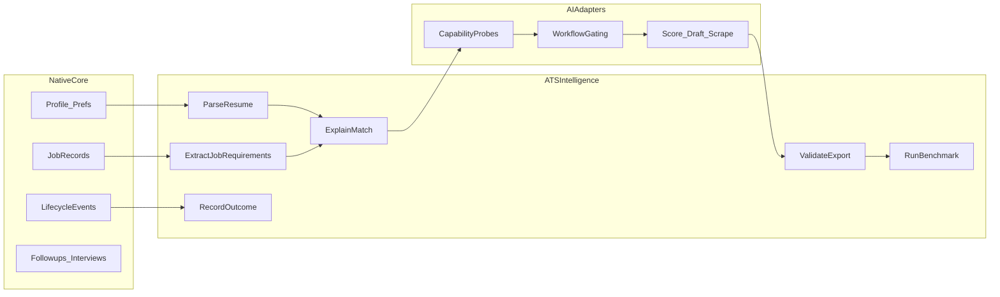

# TARGET-ARCHITECTURE

Locked architecture for the local-first Job Search Assistant with an evidence-backed **ATS Intelligence Engine**. Product remains a desktop job-search assistant — not a CLI wrapper, not a “guaranteed ATS pass” product.

---

## 1. Domains



| Domain | Owns | Does not own |
|--------|------|--------------|
| **Native core** | Editable profile, preferences, job records, lifecycle events, notes, follow-ups, manual entry, workspace safety | LLM calls, portal scraping |
| **ATS Intelligence** | Resume PDF/DOCX parse, diagnostics, structured facts + provenance, job requirement extraction, evidence-grounded match explainability, export re-parse validation, ATS benchmark harness | Employer submission, silent emails, unverifiable pass-rate claims |
| **AI adapters** | Capability-gated scoring/drafting/scraping when probes pass | Basic tracking UX, deterministic validators |

**Governing rules**

- Native core works with **zero** AI provider.
- ATS enhances with evidence; unsupported/invented statements blocked or flagged.
- AI enhances, does not own tracking.
- No silent external actions (submit/mail).
- Honesty over marketing.
- Privacy by default.
- Preserve data on failed switch/write/migrate.
- Apple Silicon tracking beta before ATS marketing claims.

---

## 2. Explicit application lifecycle

Append-only event log per application (`workspace/applications/<id>/events.jsonl`). Kanban status is a **derived view**.

**Required event types**

`discovered` · `evaluated` · `draft_created` · `documents_exported` · `user_confirmed_submitted` · `recruiter_screen_scheduled` · `recruiter_screen_completed` · `interview_scheduled` · `interview_completed` · `offer_received` · `offer_accepted` · `offer_declined` · `rejected` · `withdrawn` · `no_response` · `follow_up_due` · `follow_up_sent_recorded`

**Rules**

- Moving to Applied requires confirmation of actual submission (source + date).
- UI never labels a row “submitted” without `user_confirmed_submitted`.
- Do not rewrite a single `date` field as a substitute for event timestamps.
- Metrics (funnel, response rates) derive from events.

---

## 3. Recoverable workspace

- Absolute paths only; reject relative names.
- No silent create that orphans the previous workspace.
- On failure keep prior workspace setting intact.
- Canonicalize before persist.
- Test: symlink, unexpected file types, permissions, disk-full, concurrent writes, version migrations.

---

## 4. Canonical data model

**Canonical store** (versioned structured records + `app.db` for settings/runs):

```
workspace/
  meta.json                          # schema_version, created/migrated_at
  candidate/
    profile.json                     # facts + source/confidence/confirmed
    resume_artifacts/                # originals + parse diagnostics
  jobs/                              # job records + requirements + freshness
  applications/<id>/
    application.json
    events.jsonl
    documents/                       # exports under validation
  .backups/<timestamp>/              # pre-migration snapshots
```

**Compatibility (time-boxed)**

1. One-shot import from legacy `job_search_tracker.csv` and `job_scraper/seen_jobs.json`.
2. Optional CSV export for interoperability.
3. Dual-write only during a single schema bump with consistency checks; then canonical-only.
4. Rollback = restore `.backups/<timestamp>/` + restore `schema_version`. Never delete previous workspace on failed switch.

---

## 5. ATS Intelligence — responsibilities

1. **Ingest resume** → parsing diagnostics (pages, text coverage, missing sections, low-confidence fields) → structured facts.
2. **Extract job requirements** → must-haves / nice-to-haves with source spans.
3. **Evidence-grounded match** → strengths/gaps cite confirmed facts + extracted requirements only.
4. **Truthful tailor assist** (AI optional, capability-gated) → reorder/emphasize confirmed facts; never invent employers/dates/achievements; user review before export.
5. **Deterministic export validation** → re-parse exported PDF/DOCX; detect missing sections and unsupported statements; block or warn.
6. **Recruiter-outcome measurement hooks** → record screens/interviews/offers via lifecycle events.
7. **Benchmark suite interface** → synthetic/consented corpus; ground truth; CI-runnable; private by default.

### Native ATS API surface (conceptual)

| API | Input | Output | AI? |
|-----|-------|--------|-----|
| `ParseResume` | PDF/DOCX path | facts + diagnostics | No |
| `ExtractJobRequirements` | posting text/URL body | must/nice + spans | No (rules first; AI optional later) |
| `ExplainMatch` | confirmed facts + requirements | explanation + citations | Optional AI behind gate |
| `ValidateExport` | export path + confirmed facts | pass/warn/block + reasons | No |
| `RecordOutcome` | application id + event | appended event | No |
| `RunBenchmark` | corpus path + suite id | scores + report (local) | No |

AI adapters may assist `ExplainMatch` / tailor only when `providerSupportsWorkflow` and auth probes pass.

---

## 6. AI adapter boundary

```
UI CTA → chosenProvider.authenticated?
      → providerSupportsWorkflow(workflow)?
      → start run
      else → "Sign in" / "Open Settings" / unsupported reason
```

- Installed ≠ authenticated ≠ workflow-capable.
- Never invent success; paid calls only with approval.
- Safe cancel/interrupt; sanitized errors (no `/login` as sole recovery).
- Docs and UI share one capability matrix (`packages/core/src/providers.ts` + docs sync).

---

## 7. ATS honesty policy

Allowed with evidence: parse quality, match explanations, recruiter-response tracking.

**Forbidden without independent evidence:** universal ATS pass rate, guaranteed interviews, named-employer ATS compatibility.

Gate B (public ATS claims) requires ATS-01..06 + benchmark evidence + copy review.

---

## 8. Platform packaging

| Gate | Scope |
|------|-------|
| A | Job-tracking beta — macOS Apple Silicon first |
| B | ATS optimization claims — after Gate A + ATS evidence |
| C | Intel / Windows — per-platform Gate A (and B if claimed) |

Primary implementation host for Phase 1–6: `apps/macos-apple-silicon` with shared `packages/core` + `packages/ui`. Mirror critical Rust fixes (`deps.rs`, `workspace.rs`, `lib.rs`) to intel/windows twins in the same phase when APIs diverge.
