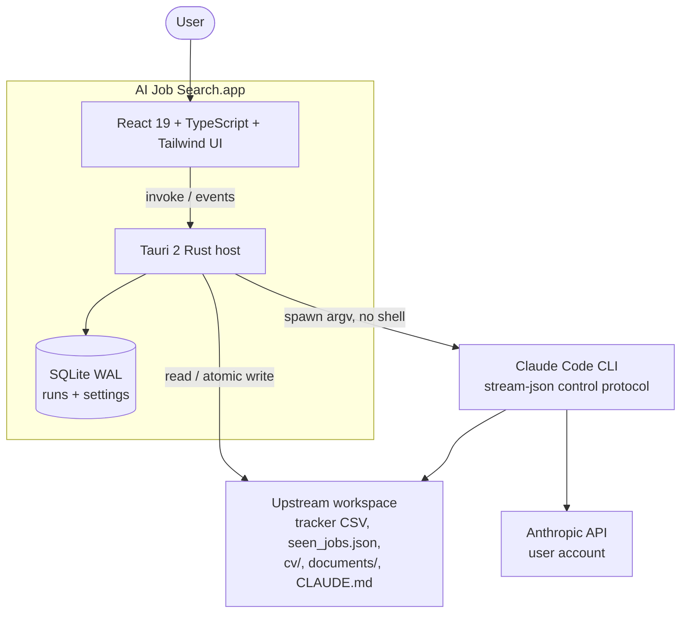

# Architecture

AI Job Search is a **local-first desktop shell**. It does not host agents in the cloud and does not replace the upstream [ai-job-search](https://github.com/ai-job-search-dev/ai-job-search) framework.

## Diagram

## Responsibilities

| Component | Owns | Does not own |
|-----------|------|--------------|
| React UI | Screens, approvals UX, PDF preview pane | Slash-command logic |
| Rust bridge | Process supervision, permissions UI wiring, deps checks | Employer submission |
| SQLite | Run events, preferences | Jobs / applications / profile content |
| Upstream files | Authoritative job-search state | App chrome |
| Claude Code | Agent workflows under your login | App packaging |

## Claude Code bridge (summary)

- Uses CLI `stream-json` I/O and the host permission protocol (verified against Claude Code 2.1.311 in project docs).
- Bidirectional: mid-run questions surface in the UI.
- No `--dangerously-skip-permissions`. Write/exec tools require a human click.
- Cancel via interrupt control request; resume via `--resume <session_id>`.

Authoritative detail: [`apps/macos-apple-silicon/docs/ARCHITECTURE.md`](../apps/macos-apple-silicon/docs/ARCHITECTURE.md).

## Local LLM

This product **does not** provide an independent local-LLM backend. AI workflows require Claude Code.
